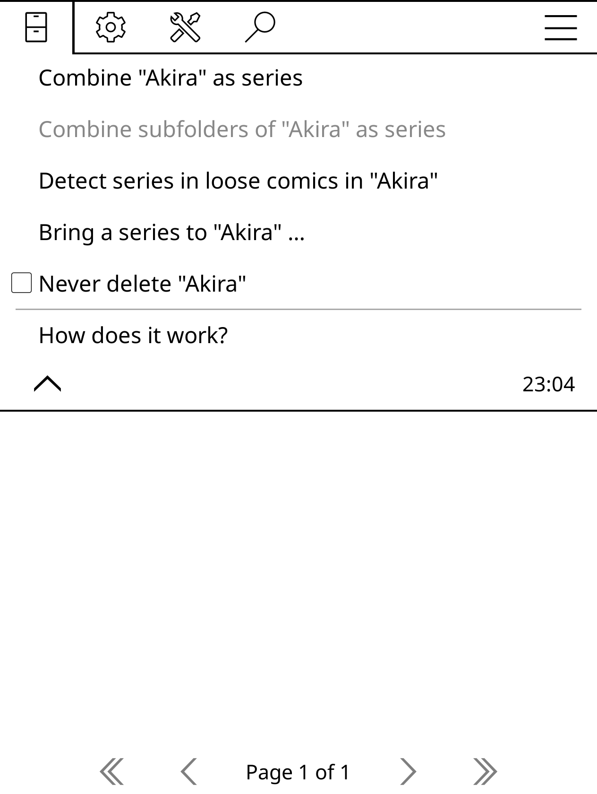
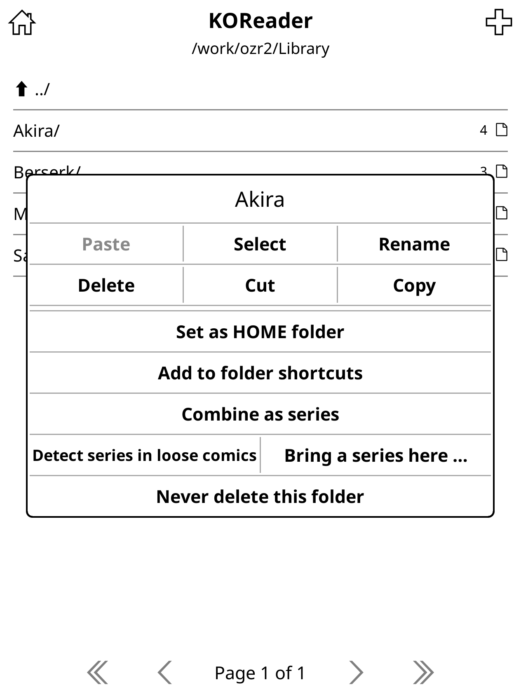
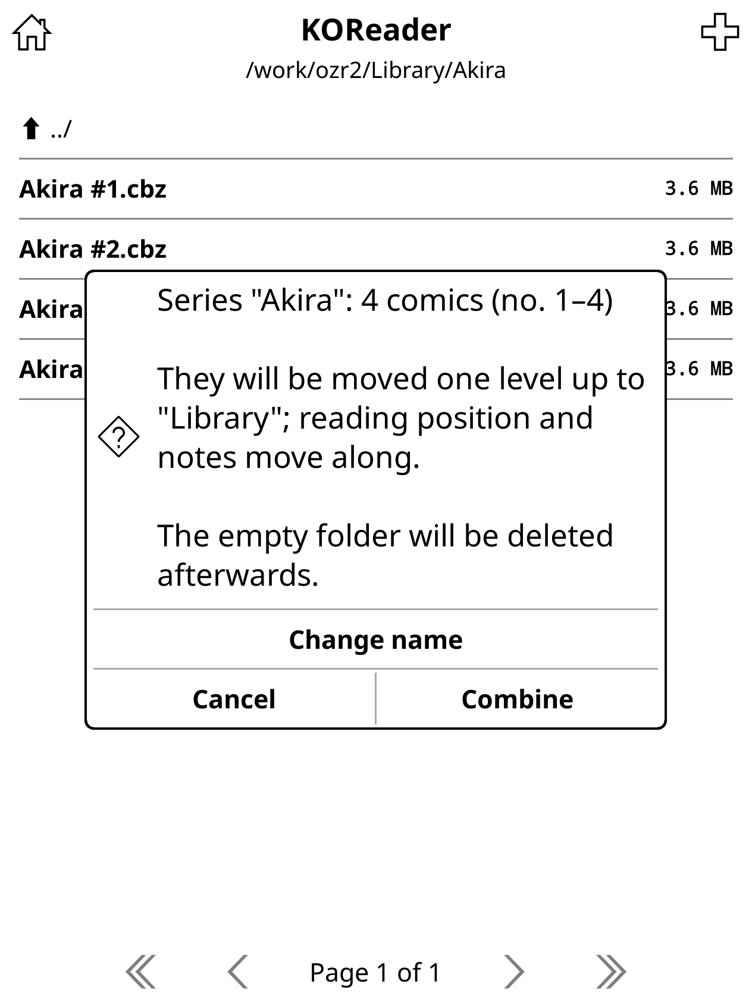
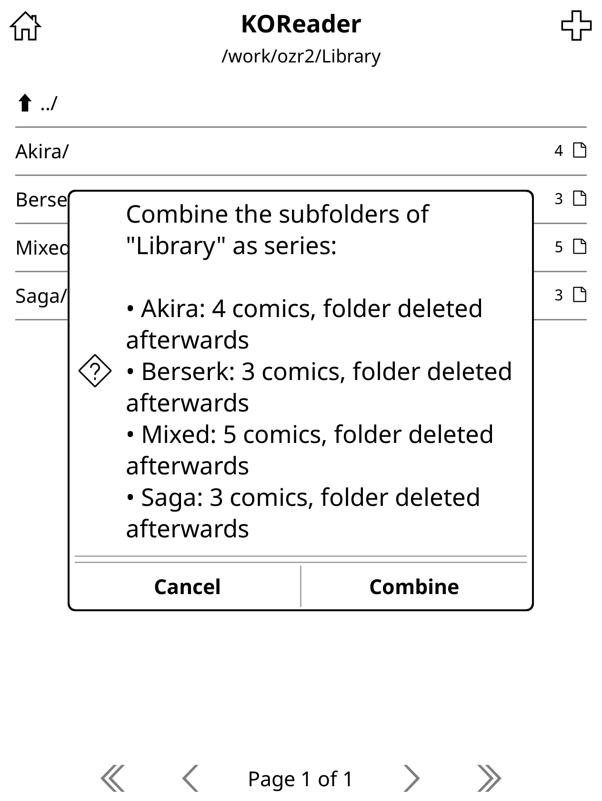
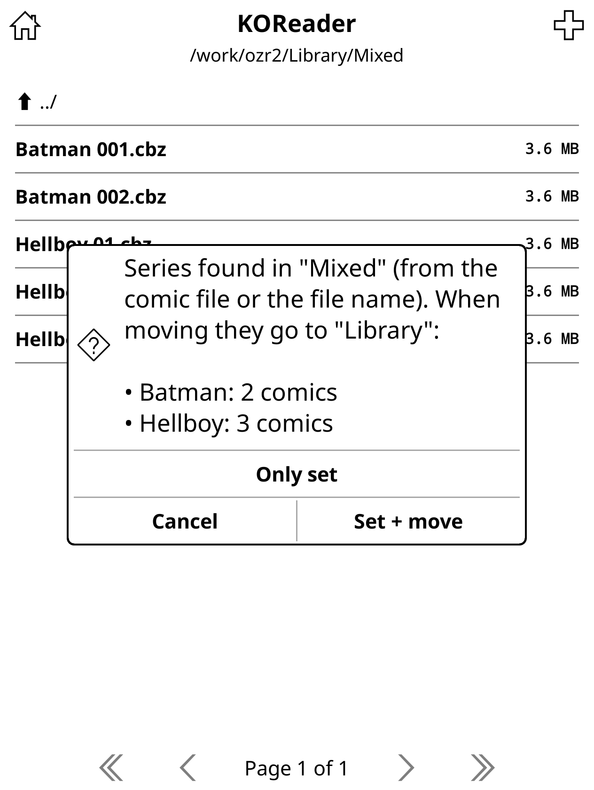
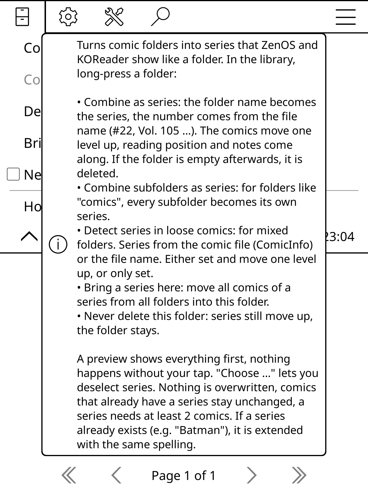

# Ordner zu Reihe für KOReader

*English: [README.md](README.md)*

<!-- byline -->
Ein Plugin von **Akrota und Claude**.

<!-- lang-note -->
*Funktioniert auf **Deutsch und Englisch**: Menüs und Texte richten sich nach der KOReader-Sprache.*

Ein KOReader-Plugin, das Comic-Ordner zu **Reihen mit Bandnummern** macht. Liegen deine Comics in Ordnern wie `Akira/Akira 01.cbz`, trägt das Plugin für jeden Comic Reihe und Nummer ein, schiebt die Comics eine Ebene höher und löscht den leeren Ordner. Bibliotheken, die Reihen als Stapel zeigen (zum Beispiel ZenOS), zeigen dann einen Stapel pro Reihe statt eines Ordners.

**Status: Prototyp / Beta.** Das Plugin verschiebt und löscht Dateien. Lies zuerst „Wichtig“ und probiere es an einem kleinen Ordner aus.

## Bildschirmfotos

*Die Bildschirmfotos zeigen die englische Oberfläche; in einem deutschen KOReader sind die Texte deutsch.*

<table>
<tr><td align="center" valign="top" width="33%"> Einträge im Werkzeuge-Menü für den offenen Ordner</td><td align="center" valign="top" width="33%"> Dialog beim langen Drücken auf einen Ordner mit den zusätzlichen Knöpfen</td><td align="center" valign="top" width="33%"> Vorschau, bevor ein Ordner zur Reihe wird</td></tr>
<tr><td align="center" valign="top" width="33%"> Vorschau für mehrere Unterordner</td><td align="center" valign="top" width="33%"> Reihen, die unter losen Comics gefunden wurden</td><td align="center" valign="top" width="33%"> Hilfetext</td></tr>
</table>

## Funktionen

- **Als Reihe zusammenfassen:** Der Ordnername wird die Reihe, die Bandnummer kommt aus dem Dateinamen (`#22`, `Vol. 105`, `Band 7`, `v01`, `Volume 2` und so weiter). Klammern, etwa mit Jahreszahlen, werden übersprungen.
- **Unterordner als Reihen zusammenfassen:** für einen Sammelordner wie `comics`: Jeder Unterordner wird seine eigene Reihe. Ordner, deren Dateinamen nach verschiedenen Titeln aussehen (nicht nach einer Reihe), werden als Sammelordner übersprungen.
- **Lose Comics als Reihen erkennen:** für gemischte Ordner. Die Reihe kommt aus der Comic-Datei (ComicInfo.xml) oder dem Dateinamen. Wahlweise „Eintragen + verschieben“ (eine Ebene höher) oder „Nur eintragen“ (die Comics bleiben, wo sie sind).
- **Reihe hierher holen:** Eine Reihe aus der Liste der Bibliothek wählen, dann werden alle ihre Comics aus allen Ordnern in den aktuellen Ordner verschoben.
- **Erst die Vorschau:** Jede Aktion zeigt vorher, was passiert, und ohne deinen Klick passiert nichts. Mit „Auswählen …“ lassen sich einzelne Reihen abwählen.
- **Vorhandene Reihen bleiben unangetastet:** Comics, die schon in einer Reihe sind, werden übersprungen. Gibt es eine Reihe schon (zum Beispiel „Batman“), wird sie mit derselben Schreibweise ergänzt.
- Lesestand, Notizen und der Bibliothekseintrag wandern mit jedem Comic mit.
- Menüs und Texte sind deutsch oder englisch, je nach KOReader-Sprache.

## Wichtig

- **Dateien werden verschoben.** Die Comics wandern in den Ordner eine Ebene höher, wie bei KOReaders Ausschneiden und Einfügen. Lesestand und Notizen (die `.sdr`-Daten), Verlauf und Sammlungen ziehen mit, und die Datenbankzeile der Bibliothek (samt Titelbild) geht mit dem Comic.
- **Nichts wird überschrieben.** Gibt es am Ziel schon eine Datei mit gleichem Namen, bleibt der Comic liegen.
- **Gelöscht werden nur leere Ordner,** und nur nach einem Verschieben. Ein Ordner, in dem noch etwas liegt, bleibt bestehen.
- **„Diesen Ordner nie löschen“** schützt einen Ordner: Reihen darin wandern trotzdem nach oben, der Ordner selbst bleibt. Gut für Ordner, die du behalten willst, zum Beispiel deinen Haupt-Comicordner.
- Eine Reihe braucht mindestens 2 Comics. Einzelne Comics bleiben, wie sie sind.
- Die Reihe wird wie bei „Buchinformationen bearbeiten“ in KOReaders eigenen Angaben gespeichert (Custom-Metadaten). Die Comic-Dateien selbst werden nicht verändert.
- Probiere es zuerst an einer Kopie oder einem kleinen Ordner aus. Es gibt kein Rückgängig.

## Installation

1. Die ZIP-Datei unter [Releases](../../releases) herunterladen und entpacken, oder dieses Projekt herunterladen.
2. Den Ordner **`ordnerzureihe.koplugin`** in den `plugins`-Ordner von KOReader kopieren. Auf dem Kobo ist das `.adds/koreader/plugins/`.
3. KOReader neu starten.

## Bedienung

**In der Bibliothek lange auf einen Ordner drücken.** Das Plugin ergänzt diese Knöpfe: „Als Reihe zusammenfassen“, „Unterordner als Reihen zusammenfassen“ (nur, wenn der Ordner Unterordner hat), „Lose Comics als Reihen erkennen“, „Reihe hierher holen …“ und „Diesen Ordner nie löschen“ (oder „Ordner wieder löschen erlauben“).

**Oder über das Menü,** für den Ordner, der gerade in der Bibliothek offen ist: oberes Menü → Werkzeug-Symbol → **Ordner zu Reihe**:

- **„…“ als Reihe zusammenfassen**
- **Unterordner von „…“ als Reihen zusammenfassen**
- **Lose Comics in „…“ als Reihen erkennen**
- **Reihe nach „…“ holen …**
- **„…“ nie löschen** (Haken)
- **Wie funktioniert das?** (kurze Erklärung)

In der Vorschau lässt sich mit „Name ändern“ ein anderer Reihenname eingeben. Bei Vorschauen über mehrere Reihen lässt sich mit „Auswählen …“ jede Reihe an- und abhaken.

## ZenOS

- Das Plugin liest Reihen aus der Bücher-Datenbank der Bibliothek, aus der ZenOS seine Reihen-Ansicht aufbaut, und erneuert nach Änderungen die gespeicherte Ordneransicht von ZenOS.
- ZenOS zeigt Knöpfe von Plugins beim langen Drücken nur, wenn **ZenOS-Einstellungen → Bibliothek → Kontextmenü → „Plugin-Aktionen“** eingeschaltet ist (ab Werk aus). Der Menüeintrag **Ordner zu Reihe** im Werkzeug-Menü funktioniert auch ohne.
- ZenOS stapelt einen Ordner nicht, in dem nur eine Reihe liegt und sonst kein loses Buch. Das ist ein Verhalten von ZenOS, kein Fehler des Plugins.
- Nach dem Verschieben vieler Comics braucht die Bibliothek einen Moment, um die Titelbilder einzulesen und die Reihen zu stapeln.

## Getestet auf

Kobo Libra Colour mit KOReader 2026.07.1 und ZenOS.

Im Ordner `tests` liegt der automatische Test aus der Entwicklung (`2-ozr-test.lua`). Er braucht eine KOReader-Testumgebung.

## Wer das gemacht hat

Den Code hat vollständig **Claude** geschrieben, eine KI von Anthropic (in Claude Code). Der Inhaber dieses Projekts hatte die Idee, hat das Plugin auf einem Kobo getestet und Rückmeldungen gegeben, aber keinen Code geschrieben.

Keine Gewährleistung und kein garantierter Support. Fehlermeldungen gern als [Issue](../../issues). Bitte `crash.log` aus dem KOReader-Ordner anhängen.

## Weitere Plugins von Akrota und Claude

- [Comic Display](https://github.com/Akrota/koreader-comic-display): Refresh gegen Ghosting, dunkle Ränder und Uhr für Comics
- [Levels / Tonwerte](https://github.com/Akrota/koreader-comic-levels): Tonwertkurve für Comics
- [Comic Panel Zoom](https://github.com/Akrota/koreader-comic-panel-zoom): Panel-für-Panel-Ansicht (Fork von JorgeTheFox)
- [Comic Dual Page](https://github.com/Akrota/koreader-comic-dual-page): Doppelseiten mit Erkennung (Fork von KORComic)
- [CBZ Converter](https://github.com/Akrota/koreader-cbz-converter): Comics, PDF und EPUB auf dem Gerät in CBZ umwandeln
- [Drive Library](https://github.com/Akrota/koreader-drive-library): Google Drive als Cloud-Bibliothek
- [Story Recall](https://github.com/Akrota/koreader-story-recall): Spoilerfreier KI-Rückblick auf Bücher
- [Guitar Tab Reader](https://github.com/Akrota/koreader-guitar-tab-reader): Gitarren-Tabs und Chords für E-Ink
- [Wi-Fi while charging](https://github.com/Akrota/koreader-wifi-while-charging): WLAN anlassen, solange das Gerät lädt
- [Zen page browser gesture](https://github.com/Akrota/koreader-zen-page-browser-gesture): Geste für den ZenOS-Seitenbrowser

## Lizenz

[MIT](LICENSE)
